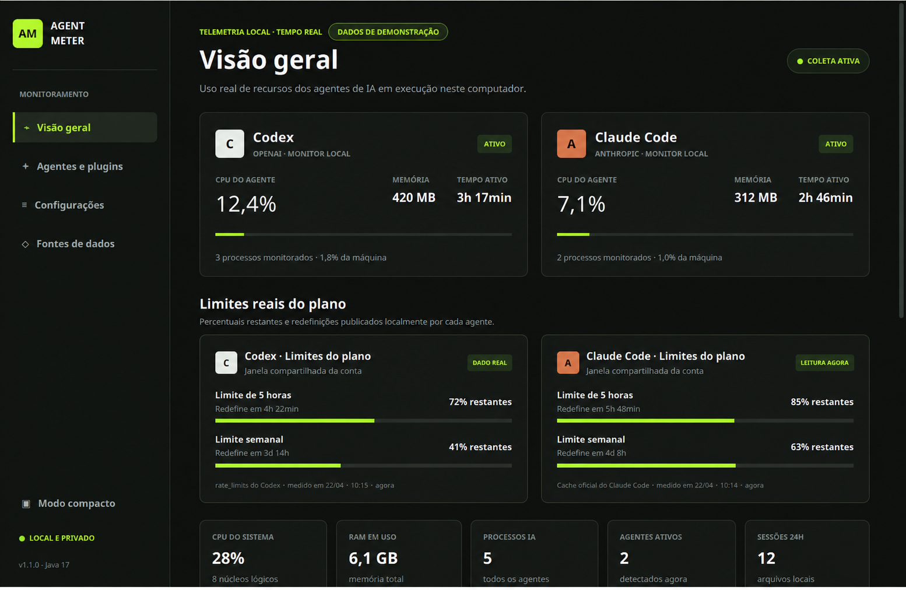
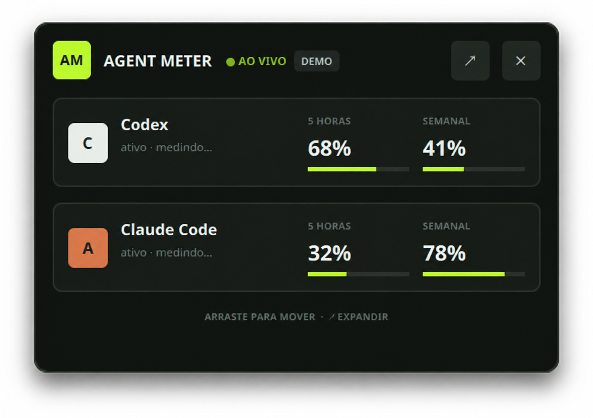
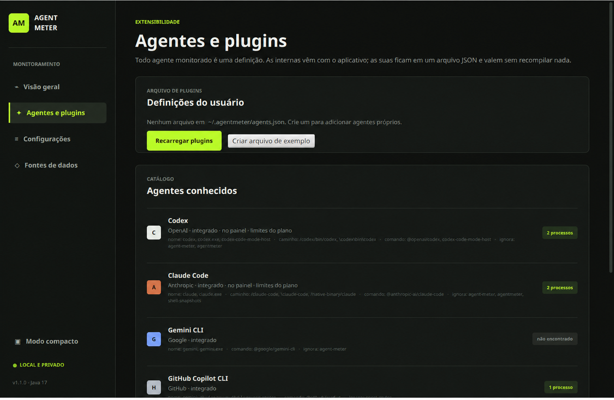

<div align="center">
  

  <br>

  **Um painel desktop leve para acompanhar agentes de IA sem tirar seus dados da máquina.**

  <br>

  
  
  
</div>

---

## Visão geral

O **Agent Meter** reúne em uma única interface o consumo de CPU, memória, tempo ativo, processos e limites reais de uso dos principais agentes de IA instalados no computador.

Ele reconhece **Codex**, **Claude Code**, **Gemini CLI**, **GitHub Copilot CLI**, **Aider**, **Cursor Agent** e **Ollama**. Agentes próprios podem ser adicionados por um arquivo JSON, sem recompilar o aplicativo.

> [!IMPORTANT]
> O processamento é local. O Agent Meter não envia telemetria, prompts, chaves ou conteúdo das suas conversas.



## Destaques

| Recurso | O que entrega |
| --- | --- |
| Monitoramento em tempo real | CPU, memória residente, processos e tempo ativo por agente |
| Limites oficiais | Janelas de 5 horas e semanal de Codex e Claude Code |
| Privacidade por padrão | Leitura e processamento realizados no próprio dispositivo |
| Modo compacto | Widget flutuante, arrastável e sempre visível |
| Agentes extensíveis | Definições personalizadas em `~/.agentmeter/agents.json` |
| Histórico visual | Últimas 60 coletas e sessões locais das últimas 24 horas |
| Multiplataforma | Empacotamento nativo para Linux, Windows e macOS |

<div align="center">
  
</div>

## Como os dados são obtidos

- **Codex:** lê o evento local mais recente de `rate_limits`.
- **Claude Code:** consulta o comando oficial `/usage` em modo não interativo e usa `cachedUsageUtilization`.
- **Sistema:** coleta CPU, memória e processos por meio da biblioteca OSHI.
- **Sessões:** conta somente arquivos locais modificados nas últimas 24 horas.

Cada janela de limite é avaliada de forma independente. Dados antigos ou indisponíveis são exibidos como `—`, nunca como uma estimativa inventada.

<details>
<summary><strong>Adicionar um agente personalizado</strong></summary>

Crie `~/.agentmeter/agents.json`:

```json
{
  "agents": [
    {
      "id": "meu-agente",
      "label": "Meu Agente",
      "provider": "Equipe interna",
      "mark": "M",
      "accent": "#8fd694",
      "primary": false,
      "usageSource": "NONE",
      "sessionsPath": ".meu-agente/sessions",
      "match": {
        "names": ["meu-agente"],
        "pathContains": ["/opt/meu-agente/"],
        "commandContains": ["@minha-empresa/meu-agente"],
        "exclude": ["agent-meter"]
      }
    }
  ]
}
```

As alterações são recarregadas automaticamente. Um `id` igual ao de um agente interno estende as regras existentes.

</details>



## Desenvolvimento

### Requisitos

- JDK 17 com `jpackage`;
- Maven 3.9 ou superior.

### Executar

```bash
mvn clean javafx:run
```

### Testar e compilar

```bash
mvn clean verify
```

### Gerar pacote nativo

```bash
# Linux: aplicativo portátil
scripts/package-unix.sh

# Linux: pacote .deb
scripts/package-unix.sh deb

# macOS: aplicativo .app
scripts/package-unix.sh

# macOS: imagem .dmg
scripts/package-unix.sh dmg
```

```powershell
# Windows: aplicativo portátil
scripts/package-windows.ps1

# Windows: instalador MSI
scripts/package-windows.ps1 msi
```

O usuário final não precisa instalar Java: o pacote nativo inclui um runtime reduzido.

## Estrutura do projeto

```text
src/main/java/          aplicação, monitoramento e interface
src/main/resources/     tema visual
src/test/java/          testes automatizados
assets/                 identidade visual
docs/                   capturas públicas com dados demonstrativos
scripts/                empacotamento multiplataforma
.github/workflows/      testes e builds automatizados
```

## Segurança e privacidade

- Nenhuma credencial deve ser incluída no repositório.
- Arquivos `.env`, chaves, artefatos de build e configurações locais são ignorados pelo Git.
- Os exemplos e screenshots públicos usam dados fictícios.
- Vulnerabilidades devem seguir a [política de segurança](SECURITY.md).

---

<div align="center">
  Feito para quem quer enxergar o consumo dos agentes sem abrir mão da privacidade.
</div>
